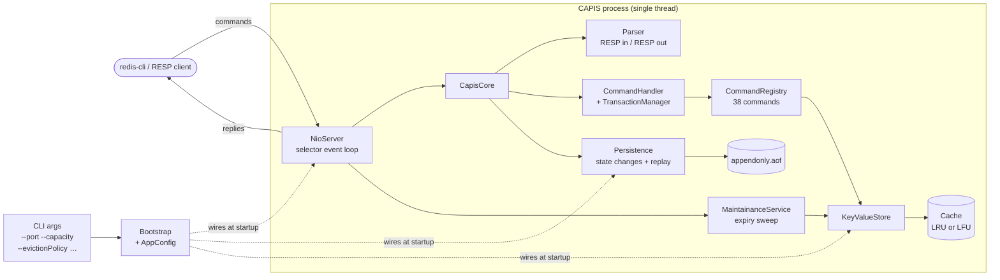

# CAPIS


CAPIS is my from-scratch Redis-like in-memory key-value store written in Java. It speaks a subset
of the Redis Serialization Protocol (RESP) over TCP and listens on port `6379` by default.

I built it to understand how a server like Redis actually works under the hood. So there is no
embedded Redis, no Netty and no Lettuce here — the storage engine is a hand-rolled cache over a
doubly linked list (LRU by default, with an LFU variant you can select), and the server is a
single-threaded, non-blocking I/O loop on top of `java.nio`.

The wiring has since been pulled apart into a small composition root (`Bootstrap`), a validated
configuration object (`AppConfig`) and a configuration loader, so the port, capacity and eviction
policy are chosen at startup instead of being scattered literals. The loader accepts `--key=value`
arguments and also reads `config.properties` when that file is present.

I want to be upfront: **this was never meant to replace Redis.** It is a learning project, and I am
happy with the scope it has reached. Everything below is what it is (and isn't) as of now.

## Features

- **RESP request decoding and response encoding** (`Parser`), including null bulk strings and nested
  arrays. Decoding is `ByteBuffer`-driven, so a partial command stays in the buffer for the next read
  instead of being thrown away.
- **A command registry**: 38 commands are registered into a `CommandRegistry`, each a `Command`
  implementation dispatched by name, plus `MULTI`, `EXEC` and `DISCARD` handled by `CommandHandler`.
- **Append-only persistence**: `FileSystem` owns `appendonly.aof`, and `Persistence` appends each
  successful state-changing command as RESP and replays the log through the command handler at
  startup. It is opt-in per command and still partial (see [Known limitations](#known-limitations)).
- **Per-connection transactions**: `MULTI` starts a queue on the connection's `ClientState`,
  subsequent commands reply `QUEUED`, and `EXEC` runs them in order and returns the array of results.
- **Five data types** in a sealed `Value` hierarchy: strings, lists, sets, hashes and sorted sets.
- **Selectable in-memory eviction**: a `Cache` abstraction is injected into `KeyValueStore`, and
  `CacheFactory` picks `LRUCache` (default) or `LFUCache` from the configured `EvictionPolicy`.
- **Expiry**: `EXPIRE`, `TTL`, `PERSIST` and `SETEX` manage TTLs explicitly, and plain writes have no
  TTL. Expired entries are removed lazily on access and by a randomized sweep that
  `MaintainanceService` runs on the event loop between `select()` calls
  (see [How the expiry sweep runs](#how-the-expiry-sweep-runs)).
- **Single-threaded, non-blocking NIO server** with no per-connection threads. Each connection owns
  a growable input and output buffer pair (`ClientState`), and reads are queued as `Task`s and drained
  after the select batch — capped at 100 per pass — so one chatty client cannot starve the rest of
  the loop. A failing command or a dropped socket tears down only that connection.
- **Startup configuration**: `AppConfig` holds validated values, `ConfigLoader` reads them from
	`config.properties` and `--key=value` arguments, and `Bootstrap` is the single place that wires
	everything together.
  Not every knob is honoured yet — see [Known limitations](#known-limitations).
- **Pipelining and inline commands** both work: several RESP commands written in one `write()` all get
  a reply, and a plain line like `PING\r\n` is accepted as an inline command.
- **`WRONGTYPE` errors** when a command is applied to the wrong data type.
- **Unknown commands** reply `-ERR Unknown command '<NAME>'` rather than a bare `+OK`.

That said, there is no replication, no authentication and no clustering. Persistence is a small
append-only log (`appendonly.aof`) built around `FileSystem` and `Persistence`, not a
Redis-compatible AOF implementation: only state-changing commands that opt in are recorded, and
startup replay is a plain re-execution of the recorded commands.

## Requirements

- **Java 26** (records, sealed interfaces and pattern matching for `instanceof` are all used).
- A Unix-like shell for the `./gradlew` commands below. On Windows, use `gradlew.bat` instead.

The Gradle wrapper uses Gradle 9.7.1 with the Foojay toolchain resolver, so a suitable JDK is
downloaded automatically if the one on your `PATH` does not match.

## Build and test

Run these from the repository root:

```sh
./gradlew build
./gradlew test
```

`./gradlew test` runs JUnit 5 tests across the test suite. They
pin the RESP parser behaviour: simple strings, integers, bulk strings, arrays, nested arrays, a null
within an array, a partial (split) read returning `null`, and two pipelined commands decoded from one
buffer. The suite also covers `AppConfig` and `ConfigLoader`, command dispatch and transactions, the
connection, key, string and list commands, the key-value store, both cache implementations and
`RandomizedList`. Persistence does not have tests yet.

The `org.graalvm.buildtools.native` plugin is also applied, so `./gradlew nativeCompile` produces a
GraalVM native image called `redis-java-clone` (built `-O3` with `--no-fallback`).

## Run the server

```sh
./gradlew run
```

The server prints its banner and then blocks on the event loop until you stop it with `Ctrl+C`. It
binds TCP port `6379`, so stop any other Redis or CAPIS instance first.

Startup values come from `ConfigLoader`. It reads `config.properties` from the working directory when
present, and accepts `--key=value` arguments:

```sh
./gradlew run --args="--port=6380 --capacity=50000 --evictionPolicy=LFU"
```

| Option | Default | Notes |
| --- | --- | --- |
| `--port` | `6379` | 0–65535. |
| `--capacity` | `100000` | Maximum live keys. |
| `--evictionPolicy` | `LRU` | `LRU` or `LFU`. |
| `--purgeLimit` | `capacity / 100`, clamped to 16–256 | Budget of the expiry sweep (see limitations). |
| `--bufferSize` | `16384` | Initial size of each connection's input and output buffers; the input side grows on demand up to 64 MB. |
| `--maxConnections` | `100` | Parsed and validated, but not enforced yet. |

An unknown option, a duplicate option or a malformed `--key=value` throws. Properties use the same
option names without the leading `--`; duplicate keys across the file and command line are rejected.
`AppConfig.Builder` validates ranges before the server is built.

If `redis-cli` is installed, connect from another terminal:

```sh
redis-cli -p 6379 ping
redis-cli -p 6379 set greeting hello
redis-cli -p 6379 get greeting
```

## A quick tour

```sh
redis-cli -p 6379 mset user:1 alice user:2 bob
redis-cli -p 6379 incr user:1

redis-cli -p 6379 rpush queue first second third
redis-cli -p 6379 lrange queue 0 -1
redis-cli -p 6379 lpop queue 2

redis-cli -p 6379 sadd tags redis java redis
redis-cli -p 6379 sismember tags java

redis-cli -p 6379 hset user:1 name alice city berlin
redis-cli -p 6379 hgetall user:1

redis-cli -p 6379 zadd board alice 10 bob 20 carol 5
redis-cli -p 6379 zrange board 0 -1 withscores

redis-cli -p 6379 setex session 100 abc
redis-cli -p 6379 ttl session
redis-cli -p 6379 expire session 60
redis-cli -p 6379 persist session
```

## Benchmark

I benchmarked the server on my machine with `valkey-benchmark` over `localhost`, 50 concurrent
connections and 100000 requests per command. The CSV output includes the latency percentiles:

```sh
valkey-benchmark -p 6379 -t ping_inline,ping_mbulk,set,get,incr,lpush,rpush,lpop,rpop,sadd,hset,zadd,mset,mget,lrange_100,lrange_300,lrange_500,lrange_600 \
  -n 100000 -c 50 --csv
```

### Environment

- CPU: Intel Core i3-2120 @ 3.30 GHz (2 cores, 4 threads)
- RAM: 11 GiB
- OS: Arch Linux (Linux 7.2.9-zen1-1-zen)
- JVM: OpenJDK 25
- Benchmark tool: `valkey-benchmark`

### Results

These numbers predate the config refactor and the persistence changes, so treat them as a rough shape
rather than a current baseline.

| Command | Requests/sec | p50 (ms) |
|---|---:|---:|
| `PING` (inline) | 62150.41 | 0.375 |
| `PING` (multibulk) | 62814.07 | 0.375 |
| `SET` | 66755.67 | 0.367 |
| `GET` | 60496.07 | 0.375 |
| `INCR` | 63938.62 |  0.375 |
| `LPUSH` | 20383.20 | 2.375 |
| `RPUSH` | 64850.84 | 0.367 |
| `LPOP` | 13933.40 | 3.471 |
| `RPOP` | 69492.70 | 0.359 |
| `SADD` | 65061.81 | 0.367 |
| `HSET` | 61124.69 | 0.375 |
| `ZADD` | 64308.68 | 0.367 |
| `MSET` (10 keys) | 67114.09 | 0.367 |
| `MGET` (10 keys) | 65274.15 | 0.383 |
| `LRANGE` (100 elements) | 42662.11 | 0.591 | 
| `LRANGE` (300 elements) | 19904.46 | 1.191 |
| `LRANGE` (500 elements) | 13871.55 | 1.703 |
| `LRANGE` (600 elements) | 12193.63 | 1.983 |

Notes:

- `valkey-benchmark` prints `WARNING: Could not fetch server CONFIG` because CAPIS
  has no `CONFIG` command. The benchmark still runs fine with its defaults.
- `LPOP` is the slowest here because the client continually refills the list, so every pop walks the
  list head and runs the lazy-expiry check.
- `INCR` spends time parsing and reformatting the string value, which is why it trails the plain
  string commands.

## Supported commands

Command names are matched case-insensitively (`args[0]` is upper-cased before lookup). There are 38
commands in the `CommandRegistry`, plus the three transaction keywords below.

### Connection

| Command | Behaviour |
| --- | --- |
| `PING` | Returns `PONG`. `PING <message>` echoes the message as a bulk string. |
| `ECHO <message>` | Returns the message as a bulk string. A bare `ECHO` replies `+ECHO` rather than erroring. |
| `HELLO [2]` | RESP handshake. Returns an array describing the server (`capis`, version `1.0.0`, proto 2, standalone, master); any protocol version other than `2` replies `-NOPROTO ...`. |

### Transactions

| Command | Behaviour |
| --- | --- |
| `MULTI` | Begins a transaction on the current connection. Nested `MULTI` replies `-ERR MULTI calls can not be nested`. |
| `EXEC` | Runs the queued commands in order and returns their replies as an array, then ends the transaction. `-ERR EXEC without MULTI` if none is active. |
| `DISCARD` | Drops the queue and ends the transaction. `-ERR DISCARD without MULTI` if none is active. |

While a transaction is active, every other command replies `+QUEUED` and is stored on the
connection's `ClientState`. `EXEC` runs each queued command through the regular dispatch path and
returns the array of results.

### Strings

| Command | Behaviour |
| --- | --- |
| `SET <key> <value>` | Stores a string and returns `OK`. Exactly two arguments; no `NX`/`XX`/`EX` options. |
| `GET <key>` | Returns the string, a null bulk string if the key is missing, or `WRONGTYPE`. |
| `MSET <k> <v> [<k> <v> ...]` | Stores several string pairs and returns `OK`. Empty values are rejected. |
| `MGET <key> [<key> ...]` | Returns an array, with a null element for missing or non-string keys. |
| `APPEND <key> <value>` | Appends, creating the key if missing. Returns the new length. |
| `STRLEN <key>` | Returns the UTF-8 byte length, `0` if missing, or `WRONGTYPE`. |
| `GETDEL <key>` | Returns the string and deletes the key; null bulk string if the key is missing. |
| `INCR <key>` | Creates the key at `1` if missing, otherwise increments and returns the new value. |
| `DECR <key>` | Creates the key at `-1` if missing, otherwise decrements and returns the new value. |
| `INCRBYFLOAT <key> <delta>` | Creates at `0` if missing, adds the delta, returns the result as a bulk string. Errors on NaN/Infinity. |
| `SETEX <key> <seconds> <value>` | Stores a string with a TTL and returns `OK`. |

### Keys

| Command | Behaviour |
| --- | --- |
| `DEL <key> [<key> ...]` | Removes keys and returns how many were deleted. |
| `EXISTS <key> [<key> ...]` | Returns the number of existing keys; duplicates are counted per occurrence. |
| `TYPE <key>` | Returns `string`, `list`, `set`, `hash`, `zset`, or `none` as a simple string. |
| `DBSIZE` | Returns the number of live keys in the store. |
| `FLUSHALL` | Deletes every key and returns `OK`. No `ASYNC`/`SYNC` argument. |

### Expiry

| Command | Behaviour |
| --- | --- |
| `EXPIRE <key> <seconds>` | Sets a TTL on an existing key, returning `1`, or `0` if the key does not exist. |
| `TTL <key>` | Remaining seconds; `-2` if missing, `-1` if the key has no TTL. |
| `PERSIST <key>` | Clears the TTL, returning `1` if a TTL was removed, `0` otherwise. |

### Lists

| Command | Behaviour |
| --- | --- |
| `LPUSH <key> <element> [<element> ...]` | Prepends elements and returns the new length. |
| `RPUSH <key> <element> [<element> ...]` | Appends elements and returns the new length. |
| `LPOP <key> [<count>]` | Pops from the head. Returns a bulk string, or an array when `count` is given. |
| `RPOP <key> [<count>]` | Pops from the tail. Returns a bulk string, or an array when `count` is given. |
| `LLEN <key>` | Returns the length, or `0` if the key is missing. |
| `LINDEX <key> <index>` | Returns the element at `index`, or a null bulk string when missing or out of range. Negative indexes count from the tail. |
| `LRANGE <key> <start> <stop>` | Returns the inclusive range, clamped to the list bounds; empty array if the key is missing. |

### Sets

| Command | Behaviour |
| --- | --- |
| `SADD <key> <member> [<member> ...]` | Adds members and returns how many were newly added. |
| `SREM <key> <member> [<member> ...]` | Removes members and returns how many were removed. |
| `SCARD <key>` | Returns the cardinality, or `0` if the key is missing. |
| `SISMEMBER <key> <member>` | Returns `1` or `0`. |
| `SMEMBERS <key>` | Returns all members as an array (order unspecified). |

### Hashes

| Command | Behaviour |
| --- | --- |
| `HSET <key> <field> <value> [<field> <value> ...]` | Sets one or more fields and returns how many fields were new. |
| `HGETALL <key>` | Returns a flat array of alternating `field, value` bulk strings. |

### Sorted sets

| Command | Behaviour |
| --- | --- |
| `ZADD <key> <score> <member> [<score> <member> ...]` | Adds members ordered by score (ties broken by member name) and returns how many members were new. |
| `ZRANGE <key> <start> <stop> [WITHSCORES]` | Inclusive range by ascending score; negative indexes count from the end. `WITHSCORES` appends each score as a bulk string. |

## How the expiry sweep runs

Expiry has two halves. On the read side, `get`, `containsKey`, `remove`, `expire`, `ttlMillis` and
`persist` all check a node's deadline and drop it the moment it is touched. On top of that, the event
loop asks `MaintainanceService` to call `KeyValueStore.purgeExpiredEntries()` once per iteration,
before it processes the ready keys. The sweep is randomized: both caches keep their entries in a
`RandomizedList`, and each pass samples up to the configured `purgeLimit` entries instead of walking
the whole keyspace. It is a piggyback strategy: no extra thread, no timer, nothing to coordinate with
the single-threaded model.

## Request lifecycle

1. `Bootstrap` is the composition root: it builds the `Cache` via `CacheFactory`, wraps it in a
   `KeyValueStore` and a `MaintainanceService`, creates the `Parser` and `CommandRegistry`, registers
	all 38 commands, builds the `CommandHandler` and `CapisCore`, creates a `FileSystem` and a
	`Persistence` service plus a `ClientStateFactory` from the configured `bufferSize`, replays the
	AOF, and finally creates the `NioServer`.
2. `NioServer` accepts a client, asks the `ClientStateFactory` for a `ClientState` (which owns an
   input and an output `ByteBuffer`), and registers the channel with a `Selector` for read readiness,
   attaching the state to the key.
3. On each loop iteration it first calls `maintainanceService.maintain()` (the expiry sweep), then
   `selector.select(10)` — a 10 ms timeout, so the sweep and the task queue still run on an idle
   server.
4. On a readable event the connection's buffer is filled and a `Task` is queued; the loop never
   decodes inline. On a writable event the output buffer is flushed and `OP_WRITE` is dropped once it
   is empty. Both the accept and read branches run inside `try`/`catch`: an `IOException` closes the
   connection, anything else tears down that key, and neither kills the loop.
5. After the ready keys, up to 100 queued tasks run (`TASKS_EXECUTION_LIMIT`). Each one flips the
   input buffer, hands it to `CapisCore.handle`, `compact()`s whatever was not consumed back to the
   front for the next read, copies the concatenated replies into the connection's output buffer and
   sets `OP_WRITE`. A task that throws replies `-ERR Internal server error` and clears the input
   buffer instead of taking the process down.
6. `CapisCore.handle` loops over the buffer, asking `Parser.decode` for one command at a time and
   appending each encoded reply, so pipelined commands are all answered. A `null` decode result —
   incomplete or undecodable input — just stops the loop and leaves the bytes for the next read, and
   an empty command replies `-ERR empty command`.
7. `CommandHandler.execute` upper-cases the first argument. `MULTI`/`EXEC`/`DISCARD` are handled
   inline; otherwise the name is looked up in the `CommandRegistry`, or — if the connection is inside
   a transaction — the command is queued and `+QUEUED` is returned.
8. Back in `CapisCore`, if the command was found, declares `changesState()` and its reply was not an
   error, `Persistence.handle` asks it for a `persistentCommand` representation, `Parser.encode`s
   that, and `FileSystem.append` writes it to `appendonly.aof`. Startup replay decodes each recorded
   array and runs it through `CommandHandler` without writing it back.

Replies are never written from the decode path; they wait in the output buffer until the next
writable event, which is what keeps a slow reader from blocking command processing.

## Project structure

```text
app/src/main/java/com/capis/App.java                         Entry point, prints the banner
app/src/main/java/com/capis/Config/AppConfig.java             Validated config + builder + defaults
app/src/main/java/com/capis/Banner.java                      ASCII banner + startup summary box
app/src/main/java/com/capis/Config/ConfigLoader.java          Reads config.properties and parses --key=value arguments
app/src/main/java/com/capis/DataTypes/EvictionPolicy.java    LRU / LFU enum
app/src/main/java/com/capis/Bootstrap.java                   Composition root, wires everything
app/src/main/java/com/capis/CapisCore.java                   Decode / execute / encode facade
app/src/main/java/com/capis/MaintainanceService.java         Runs the expiry sweep each loop
app/src/main/java/com/capis/Network/NioServer.java           Non-blocking TCP server, task queue, event loop
app/src/main/java/com/capis/Network/ClientState.java         Per-connection input/output buffers + MULTI queue
app/src/main/java/com/capis/Network/ClientStateFactory.java  Builds ClientState with the configured buffer size
app/src/main/java/com/capis/Network/Task.java                Queued read: channel + state, drained after select
app/src/main/java/com/capis/Parser/Parser.java               RESP decoding and encoding
app/src/main/java/com/capis/FileSystem/FileSystem.java       Buffered append/read for the AOF file
app/src/main/java/com/capis/Persistence/Persistence.java     Records state changes and replays the AOF
app/src/main/java/com/capis/Commands/                        Command interface, handler, one class per command
app/src/main/java/com/capis/Commands/CommandRegistry.java    Name -> Command lookup
app/src/main/java/com/capis/Commands/TransactionManager.java MULTI/EXEC/DISCARD queueing
app/src/main/java/com/capis/entities/Cache.java              Cache abstraction (eviction + expiry)
app/src/main/java/com/capis/entities/CacheFactory.java       Picks LRUCache or LFUCache from config
app/src/main/java/com/capis/entities/KeyValueStore.java      Facade over the cache
app/src/main/java/com/capis/entities/LRUCache.java           Capacity-bounded LRU cache, expiry + sweep
app/src/main/java/com/capis/entities/LFUCache.java           Frequency-bucketed LFU cache, same contract
app/src/main/java/com/capis/entities/DoublyLinkedList.java   Recency / frequency ordering, package private
app/src/main/java/com/capis/entities/RandomizedList.java     O(1) random sampling for the sweep
app/src/main/java/com/capis/entities/Node.java               Cache entry
app/src/main/java/com/capis/DataTypes/Core/                   Sealed Value interface, its five types, ScoreMember
app/src/main/java/com/capis/DataTypes/RespValues/             RespValue and its five record types
app/src/test/java/com/capis/AppConfigTest.java               Config defaults, validation, purge limit
app/src/test/java/com/capis/ConfigLoaderTest.java            Argument parsing and file loading
app/src/test/java/com/capis/Commands/                        Connection/key/string/list + handler tests
app/src/test/java/com/capis/entities/                        Store, cache and randomized-list tests
app/src/test/java/com/capis/Parser/ParserTest.java           RESP parser tests
gradle/wrapper/                                              Gradle wrapper files
```

`docs/` is in `.gitignore`, so the design notes and rough-edge checklists I keep there are local only
and are not part of the repository.

## Known limitations

This is the honest picture of what CAPIS does not do yet. I wrote it down mainly so I don't fool
myself later — and because a learning project is more useful when its edges are visible. None of this
is a knock on the project; it is just the current scope.

### Protocol and server

- A connection's input buffer grows on demand, but only up to 64 MB; a request larger than that gets
  the connection closed instead of a reply.
- A client can send `$-1` (a null bulk) as an argument; only `LPUSH`, `MSET` and `MGET` guard against
  the resulting `null` argument explicitly, so some other commands fall through to the task's
  internal-error reply.
- Malformed RESP is not turned into a clean protocol error that closes the connection; the decode
  result is just "not decodable", so recovery is best-effort.
- There is no `CONFIG` command, so `valkey-benchmark` prints `WARNING: Could not fetch server CONFIG`.
- There is no `KEYS` or `SCAN`, so the keyspace cannot be enumerated from a client. `LRUCache` still
  has a `keys()` helper, but it is left out of the `Cache` interface and no command uses it.

### Configuration

- Configuration comes from `config.properties` and `--key=value` arguments. Environment variables
	and `capis.properties` are not implemented.
- `--maxConnections` is parsed and range-checked but not enforced: the server accepts as many
  clients as the OS lets it.
- `--purgeLimit` is computed, validated and printed in the banner, and `CacheFactory` passes it to
	both cache implementations.
- Eviction policy is startup-only. Switching LRU to LFU while keys exist is not a live change.
- The AOF file is always `appendonly.aof`: `AppConfig` has an `aofFileName` field and
  `Builder.setAofFileName`, but `ConfigLoader` has no option for it.

### Storage and expiry

- Capacity defaults to a silent 100000 entries: once it is reached, `LRUCache` drops the
  least-recently-used key and `LFUCache` drops the least-frequently-used one, with no signal either
  way.
- The expiry sweep only samples up to `purgeLimit` entries per event-loop pass, so an expired key can
	stay in memory for a little while until it is either touched or reached by the sweep.
- Sets are backed by a `HashSet` and sorted sets by a `TreeSet` with a linear `find`, so `SMEMBERS`
  order is unspecified and `ZADD`/`ZRANGE` are O(n).
- Lists are backed by `ArrayDeque`, so pushes and pops at either end are O(1), but `LINDEX` and
  `LRANGE` walk the deque.

### Command semantics

- `SET`, `MSET` and `SETEX` take no option keywords, and `MSET` rejects empty-string values.
- `INCR`/`DECR` use `Integer.parseInt` for their reply, so values past the 32-bit range wrap instead
  of widening; a wrong-typed key is reported as `value is not an integer or out of range` rather than
  `WRONGTYPE`.
- `APPEND` returns a character count when it creates the key and a byte count when it extends one,
  while `STRLEN` always counts bytes.
- `LPOP`/`RPOP key 1` returns a bulk string where Redis 6.2+ returns a one-element array, and a
  missing key with an explicit count returns an empty array rather than a nil array.
- `EXPIRE` and `SETEX` accept a TTL of `0` (the key dies immediately) and reject only negative values.
- The `WRONGTYPE` responses vary slightly in wording across commands (the implementation uses both
  `-WRONGTYPE ...` and `-ERR WRONGTYPE ...` forms).

### Transactions

- There is no `WATCH`/`UNWATCH` and no optimistic locking.
- Queue-time validation is missing: an unknown command or a wrong arity is queued as `+QUEUED` and only
  surfaces as an error inside the `EXEC` reply (real Redis rejects it at queue time).
- Transactions are per-connection, and isolation comes from the single-threaded event loop rather
  than from any explicit locking.

### Persistence

- Only commands that opt into `changesState()` and `persistentCommand()` are recorded. Today that is
  `SET`, `SETEX`, `MSET`, `INCR`, `DECR`, `INCRBYFLOAT`, `DEL`, `EXPIRE`, `PERSIST`, `GETDEL`,
  `FLUSHALL`, `LPUSH`, `RPUSH` and `SREM`. `APPEND`, `SADD`, `HSET`, `ZADD`, `LPOP`, `RPOP` and
  others are not persisted, so their effects are lost on restart.
- `Persistence` logs every state-changing command whose dispatch reply is not an error. That includes
  commands queued inside `MULTI` (their reply is `+QUEUED`), so `DISCARD` does not remove entries
  already written to the log.
- Replay decodes the log and re-runs commands through `CommandHandler`. There is no snapshotting,
  fsync policy, log rewrite/compaction, replication, authentication, clustering or blocking commands.

I deliberately left the bigger pieces — replication, pub/sub, clustering, ACLs — for later or out of
scope entirely. They are a different kind of project from the one I set out to build.

## System diagram

The whole server is one process and one thread: a client speaks RESP over TCP, the event loop hands
bytes to the core, commands read and write the store, and the cache does the eviction and expiry.
`Bootstrap` builds that graph once at startup from `AppConfig`.



## Class diagram

```mermaid
classDiagram
	class App {
		+main(String[] args) void
	}

	class Banner {
		+print(int port, String evictionPolicy, int capacity, int purgeLimit) void
	}

	class ConfigLoader {
		-Map~String, String~ configMap
		+ConfigLoader()
		+load(String[] args) AppConfig
		-parseArgs(String[] args) Map~String, String~
	}

	class AppConfig {
		-int port
		-int maxConnections
		-int capacity
		-int bufferSize
		-EvictionPolicy evictionPolicy
		-int purgeLimit
		-String aofFileName
		+getPort() int
		+getMaxConnections() int
		+getCapacity() int
		+getBufferSize() int
		+getEvictionPolicy() EvictionPolicy
		+getPurgeLimit() int
		+getAofFileName() String
	}

	class Builder {
		+setPort(int port) Builder
		+setMaxConnections(int n) Builder
		+setCapacity(int c) Builder
		+setBufferSize(int b) Builder
		+setEvictionPolicy(EvictionPolicy p) Builder
		+setPurgeLimit(int l) Builder
		+setAofFileName(String fileName) Builder
		+build() AppConfig
		-calculatePurgeLimit(int capacity) int
	}

	class EvictionPolicy {
		<<enumeration>>
		LRU
		LFU
	}

	class Bootstrap {
		-AppConfig appConfig
		+Bootstrap(AppConfig appConfig)
		+build() NioServer
		-addCommandsToRegistry(CommandRegistry registry, KeyValueStore store) void
	}

	class NioServer {
		~int port
		-CapisCore capisCore
		-Selector selector
		-MaintainanceService maintainanceService
		-Queue~Task~ pendingTasks
		~int TASKS_EXECUTION_LIMIT
		-ClientStateFactory clientStateFactory
		+NioServer(int port, CapisCore capisCore, MaintainanceService maintainanceService, ClientStateFactory clientStateFactory)
		+start() void
		-acceptClient(ServerSocketChannel server) void
		-read(SelectionKey key) void
		-executePendingTasks() void
		-executePendingTask(Task task) void
		~sendMessage(SocketChannel client, String message) void
		-write(SelectionKey key) void
		-closeConnection(SelectionKey key) void
	}

	class Task {
		-SocketChannel client
		-ClientState clientState
		+Task(SocketChannel client, ClientState clientState)
		+getClient() SocketChannel
		+getClientState() ClientState
	}

	class ClientStateFactory {
		~int bufferSize
		+ClientStateFactory(int bufferSize)
		+createClientState() ClientState
	}

	class MaintainanceService {
		-KeyValueStore keyValueStore
		+MaintainanceService(KeyValueStore keyValueStore)
		+maintain() void
	}

	class CapisCore {
		-Parser parser
		-CommandHandler commandHandler
		-Persistence persistence
		+CapisCore(Parser parser, CommandHandler commandHandler, Persistence persistence)
		+handle(ByteBuffer buffer, ClientState clientState) String
	}

	class Persistence {
		-FileSystem fileSystem
		+Persistence(FileSystem fileSystem)
		+handle(Command command, Parser parser, String[] args) void
		+replay(Parser parser, CommandHandler commandHandler, ClientState replayClientState) void
	}

	class FileSystem {
		-BufferedWriter writer
		-String fileName
		+FileSystem(String fileName)
		+open(String fileName) void
		+append(String data) void
		+close() void
		+readAll() byte[]
	}

	class Parser {
		+decode(ByteBuffer buffer) String[]
		+encode(RespValue value) String
		-serializeBulkString(String value) String
		-serializeArray(RespArray value) String
		-parseElement(ByteBuffer buffer, List accumulator) boolean
		-readLine(ByteBuffer inputBuffer) String
		-readBulkString(ByteBuffer inputBuffer, long length) String
	}

	class CommandHandler {
		-CommandRegistry commandRegistery
		-TransactionManager transactionManager
		+CommandHandler(CommandRegistry commandRegistery)
		+execute(String[] args, ClientState clientState) RespValue
		+executeTransaction(ClientState clientState) RespValue
		+executeImmediately(String[] args) RespValue
		+GetCommand(String commandName) Command
	}

	class CommandRegistry {
		-Map~String, Command~ commandMap
		+register(Command command) void
		+get(String name) Command
	}

	class TransactionManager {
		+begin(ClientState clientState) void
		+queue(ClientState clientState, String[] command) void
		+takeQueuedCommands(ClientState clientState) List~String[]~
		+end(ClientState clientState) void
		+isActive(ClientState clientState) boolean
	}

	class Command {
		<<interface>>
		+getName() String
		+changesState() boolean
		+execute(String[] args) RespValue
		+persistentCommand(String[] args) RespValue
	}

	class PingCommand
	class EchoCommand
	class GetCommand
	class SetCommand
	class MSetCommand
	class MGetCommand
	class AppendCommand
	class STRLENCommand
	class GETDELCommand
	class INCRCommand
	class DECRCommand
	class INCRBYFLOATCommand
	class SETEXCommand
	class DELCommand
	class EXISTSCommand
	class TypeCommand
	class DBSIZECommand
	class FLUSHALLCommand
	class EXPIRECommand
	class TTLCommand
	class PERSISTCommand
	class LPUSHCommand
	class RPushCommand
	class LPOPCommand
	class RPOPCommand
	class LLENCommand
	class LIndexCommand
	class LRangeCommand
	class SADDCommand
	class SREMCommand
	class SCARDCommand
	class SISMEMBERCommand
	class SMEMBERSCommand
	class HSETCommand
	class HGETALLCommand
	class ZADDCommand
	class ZRANGECommand
	class HELLOCommand

	class ClientState {
		-boolean inTransaction
		-List~String[]~ queue
		-ByteBuffer inputBuffer
		-ByteBuffer outputBuffer
		+ClientState(int bufferSize)
		+ClientState()
		+discardTransaction() void
		+isInTransaction() boolean
		+beginTransaction() void
		+endTransaction() void
		+queueCommand(String[] command) void
		+getQueue() List~String[]~
		+getInputBuffer() ByteBuffer
		+getOutputBuffer() ByteBuffer
		+growInputBuffer() boolean
		+ensureOutputCapacity(int extraBytes) ByteBuffer
	}

	class KeyValueStore {
		-Cache~String, Value~ cache
		+KeyValueStore(Cache~String, Value~ cache)
		+get(String key) Value~?~
		+put(String key, Value~?~ value) void
		+remove(String key) Value~?~
		+containsKey(String key) boolean
		+put(String key, Value~?~ value, long ttlMillis) void
		+expire(String key, long ttlMillis) boolean
		+ttlMillis(String key) Long
		+persist(String key) boolean
		+size() int
		+clear() void
		+increment(String key) Value~?~
		+decrement(String key) Value~?~
		+purgeExpiredEntries() void
	}

	class Cache~K, V~ {
		<<interface>>
		+get(K key) V
		+put(K key, V value) void
		+put(K key, V value, long expiryAtMillis) void
		+remove(K key) V
		+containsKey(K key) boolean
		+size() int
		+clear() void
		+expire(K key, long ttlMillis) boolean
		+ttlMillis(K key) Long
		+persist(K key) boolean
		+purgeExpiredEntries() void
	}

	class CacheFactory {
		+createCache(int capacity, EvictionPolicy policy, int purgeLimit) Cache~String, Value~
	}

	class LRUCache~K, V~ {
		-DoublyLinkedList~K, V~ list
		-long capacity
		-Map~K, Node~ map
		-RandomizedList~Node~ randomList
		-int purgeLimit
		+LRUCache(int capacity)
		+LRUCache(int capacity, int purgeLimit)
		+get(K key) V
		+put(K key, V value) void
		+put(K key, V value, long expiryAtMillis) void
		+remove(K key) V
		+containsKey(K key) boolean
		+expire(K key, long ttlMillis) boolean
		+ttlMillis(K key) Long
		+persist(K key) boolean
		+keys() Set~K~
		+size() int
		+clear() void
		+purgeExpiredEntries() void
		-putInternal(K key, V value, long expiryAtMillis) void
		-removeIfExpired(Node~K, V~ node) boolean
	}

	class LFUCache~K, V~ {
		-Map~K, Node~ map
		-Map~Integer, DoublyLinkedList~ frequencyMap
		-SortedSet~Integer~ frequencySet
		-RandomizedList~Node~ randomizedList
		-int capacity
		-int minFrequency
		-int purgeLimit
		+LFUCache(int capacity)
		+LFUCache(int capacity, int purgeLimit)
		+get(K key) V
		+put(K key, V value) void
		+put(K key, V value, long expiryAtMillis) void
		+remove(K key) V
		+containsKey(K key) boolean
		+size() int
		+clear() void
		+expire(K key, long ttlMillis) boolean
		+ttlMillis(K key) Long
		+persist(K key) boolean
		+purgeExpiredEntries() void
		+add(Node~K, V~ node, int freq) void
		+remove(Node~K, V~ node) void
		-updateFreq(Node~K, V~ node) void
		-evictNode() void
	}

	class RandomizedList~E~ {
		-List~E~ list
		-Map~E, Integer~ indexMap
		+add(E element) boolean
		+remove(E element) boolean
		+get(int index) E
		+size() int
		+isEmpty() boolean
		+clear() void
	}

	class DoublyLinkedList~K, V~ {
		-Node~K, V~ head
		-Node~K, V~ tail
		+DoublyLinkedList()
		+addToFront(Node~K, V~ node) void
		+remove(Node~K, V~ node) void
		+removeFromEnd() Node~K, V~
		+moveToFront(Node~K, V~ node) void
		+nodes() List~Node~
		+isEmpty() boolean
		+clear() void
	}

	class Node~K, V~ {
		+K key
		+V value
		+long expiryAtMillis
		+int frequency
		+Node~K, V~ next
		+Node~K, V~ prev
	}

	class Value~T~ {
		<<sealed interface>>
		+getValue() T
		+setValue(T value) void
	}

	class StringValue
	class ListValue
	class SetValue
	class SortedSetValue
	class HashValue

	class ScoreMember {
		+double score
		+String member
		+compareTo(ScoreMember other) int
	}

	class RespValue {
		<<interface>>
	}

	class RespArray {
		<<record>>
		+List~RespValue~ values
	}

	class RespBulkString {
		<<record>>
		+String value
	}

	class RespErr {
		<<record>>
		+String type
		+String message
	}

	class RespInteger {
		<<record>>
		+int value
	}

	class RespSimpleString {
		<<record>>
		+String value
	}

	App --> ConfigLoader : loads
	App --> Bootstrap : builds
	App --> NioServer : starts
	App ..> Banner : prints
	ConfigLoader ..> Builder : fills
	Builder ..> AppConfig : constructs
	Builder --> EvictionPolicy : validates
	AppConfig *-- Builder : inner
	AppConfig --> EvictionPolicy : holds
	Bootstrap --> AppConfig : reads
	Bootstrap ..> CacheFactory : creates cache
	Bootstrap *-- KeyValueStore : wires
	Bootstrap *-- MaintainanceService : wires
	Bootstrap *-- CommandRegistry : registers commands
	Bootstrap *-- CapisCore : wires
	Bootstrap *-- Persistence : wires
	Bootstrap --> NioServer : returns
	CacheFactory ..> Cache : returns
	CacheFactory ..> LRUCache : creates for LRU
	CacheFactory ..> LFUCache : creates for LFU
	NioServer *-- CapisCore : dispatches to
	NioServer *-- MaintainanceService : calls maintain()
	NioServer *-- ClientStateFactory : builds ClientState
	NioServer o-- Task : queues reads
	ClientStateFactory ..> ClientState : creates
	MaintainanceService --> KeyValueStore : sweeps expiry
	CapisCore *-- Parser
	CapisCore *-- CommandHandler
	CapisCore *-- Persistence
	Persistence *-- FileSystem : appends to
	Persistence --> Command : asks for persistent form
	Persistence --> Parser : encodes
	Persistence --> CommandHandler : replays through
	CommandHandler o-- CommandRegistry : looks up
	CommandHandler *-- TransactionManager
	CommandHandler --> ClientState : reads/queues per connection
	CommandHandler --> Command : dispatches to
	CommandRegistry o-- Command : registry
	TransactionManager --> ClientState : mutates
	NioServer --> ClientState : attaches per channel
	Command <|.. PingCommand
	Command <|.. EchoCommand
	Command <|.. GetCommand
	Command <|.. SetCommand
	Command <|.. MSetCommand
	Command <|.. MGetCommand
	Command <|.. AppendCommand
	Command <|.. STRLENCommand
	Command <|.. GETDELCommand
	Command <|.. INCRCommand
	Command <|.. DECRCommand
	Command <|.. INCRBYFLOATCommand
	Command <|.. SETEXCommand
	Command <|.. DELCommand
	Command <|.. EXISTSCommand
	Command <|.. TypeCommand
	Command <|.. DBSIZECommand
	Command <|.. FLUSHALLCommand
	Command <|.. EXPIRECommand
	Command <|.. TTLCommand
	Command <|.. PERSISTCommand
	Command <|.. LPUSHCommand
	Command <|.. RPushCommand
	Command <|.. LPOPCommand
	Command <|.. RPOPCommand
	Command <|.. LLENCommand
	Command <|.. LIndexCommand
	Command <|.. LRangeCommand
	Command <|.. SADDCommand
	Command <|.. SREMCommand
	Command <|.. SCARDCommand
	Command <|.. SISMEMBERCommand
	Command <|.. SMEMBERSCommand
	Command <|.. HSETCommand
	Command <|.. HGETALLCommand
	Command <|.. ZADDCommand
	Command <|.. ZRANGECommand
	Command <|.. HELLOCommand
	GetCommand --> KeyValueStore
	SetCommand --> KeyValueStore
	MSetCommand --> KeyValueStore
	MGetCommand --> KeyValueStore
	AppendCommand --> KeyValueStore
	STRLENCommand --> KeyValueStore
	GETDELCommand --> KeyValueStore
	INCRCommand --> KeyValueStore
	DECRCommand --> KeyValueStore
	INCRBYFLOATCommand --> KeyValueStore
	SETEXCommand --> KeyValueStore
	DELCommand --> KeyValueStore
	EXISTSCommand --> KeyValueStore
	TypeCommand --> KeyValueStore
	DBSIZECommand --> KeyValueStore
	FLUSHALLCommand --> KeyValueStore
	EXPIRECommand --> KeyValueStore
	TTLCommand --> KeyValueStore
	PERSISTCommand --> KeyValueStore
	LPUSHCommand --> KeyValueStore
	RPushCommand --> KeyValueStore
	LPOPCommand --> KeyValueStore
	RPOPCommand --> KeyValueStore
	LLENCommand --> KeyValueStore
	LIndexCommand --> KeyValueStore
	LRangeCommand --> KeyValueStore
	SADDCommand --> KeyValueStore
	SREMCommand --> KeyValueStore
	SCARDCommand --> KeyValueStore
	SISMEMBERCommand --> KeyValueStore
	SMEMBERSCommand --> KeyValueStore
	HSETCommand --> KeyValueStore
	HGETALLCommand --> KeyValueStore
	ZADDCommand --> KeyValueStore
	ZRANGECommand --> KeyValueStore
	Parser --> RespValue : encodes to
	Parser ..> RespArray : builds
	KeyValueStore *-- Cache : delegates to
	KeyValueStore --> Value : holds
	Cache <|.. LRUCache
	Cache <|.. LFUCache
	LRUCache *-- DoublyLinkedList : maintains recency
	LRUCache o-- Node : indexes nodes
	LRUCache *-- RandomizedList : samples for sweep
	LFUCache *-- DoublyLinkedList : frequency buckets
	LFUCache o-- Node : indexes nodes
	LFUCache *-- RandomizedList : samples for sweep
	DoublyLinkedList o-- Node : links nodes
	Node --> Node : next / prev
	Value~T~ <|.. StringValue
	Value~T~ <|.. ListValue
	Value~T~ <|.. SetValue
	Value~T~ <|.. SortedSetValue
	Value~T~ <|.. HashValue
	SortedSetValue --> ScoreMember : contains
	RespValue <|.. RespArray
	RespValue <|.. RespBulkString
	RespValue <|.. RespErr
	RespValue <|.. RespInteger
	RespValue <|.. RespSimpleString
```



Generated Gradle output, compiled classes, IDE metadata, logs and local environment files are
excluded by `.gitignore`.
