# CAPIS

```
   ██████╗ █████╗ ██████╗ ██╗███████╗
  ██╔════╝██╔══██╗██╔══██╗██║██╔════╝
  ██║     ███████║██████╔╝██║███████╗
  ██║     ██╔══██║██╔═══╝ ██║╚════██║
  ╚██████╗██║  ██║██║     ██║███████║
   ╚═════╝╚═╝  ╚═╝╚═╝     ╚═╝╚══════╝

CAPIS v0.1.0 - A Redis like In-Memory Key-Value Store
```

CAPIS is my from-scratch Redis-like in-memory key-value store written in Java. It speaks a subset
of the Redis Serialization Protocol (RESP) over TCP and listens on port `6379` by default.

I built it to understand how a server like Redis actually works under the hood. So there is no
embedded Redis, no Netty and no Lettuce here — the storage engine is a hand-rolled LRU cache over a
doubly linked list, and the server is a single-threaded, non-blocking I/O loop on top of `java.nio`.

I want to be upfront: **this was never meant to replace Redis.** It is a learning project, and I am
happy with the scope it has reached. Everything below is what it is (and isn't) as of now.

## Features

- **RESP request decoding and response encoding** (`Parser`), including null bulk strings and nested
  arrays. Decoding is `ByteBuffer`-driven, so a partial command stays in the buffer for the next read
  instead of being thrown away.
- **A pluggable command registry**: 37 registered commands, each a `Command` implementation
  dispatched by name, plus `MULTI`, `EXEC` and `DISCARD` handled directly by the registry.
- **Per-connection transactions**: `MULTI` starts a queue on the connection's `ClientState`,
  subsequent commands reply `QUEUED`, and `EXEC` runs them in order and returns the array of results.
- **Five data types** in a sealed `Value` hierarchy: strings, lists, sets, hashes and sorted sets.
- **In-memory LRU storage** with a capacity of 10000 entries (`App` passes `10000` to `CapisCore`).
- **Expiry**: `EXPIRE`, `TTL`, `PERSIST` and `SETEX` manage TTLs explicitly, and plain writes have no
  TTL. Expired entries are removed lazily on access and by a small sweep that runs on the event loop
  between `select()` calls (see [How the expiry sweep runs](#how-the-expiry-sweep-runs)).
- **Single-threaded, non-blocking NIO server** with no per-connection threads. Each connection owns an
  8 KB input buffer (`ClientState`), and the accept/read branches are wrapped so a failing command or
  a dropped socket tears down only that connection instead of the event loop.
- **Pipelining and inline commands** both work: several RESP commands written in one `write()` all get
  a reply, and a plain line like `PING\r\n` is accepted as an inline command.
- **`WRONGTYPE` errors** when a command is applied to the wrong data type.
- **Unknown commands** reply `-ERR Unknown command '<NAME>'` rather than a bare `+OK`.

That said, there is no persistence, no replication, no authentication and no clustering. All data
lives in memory and is lost when the process stops.

## Requirements

- **Java 26** (records, sealed interfaces and pattern matching for `instanceof` are all used).
- A Unix-like shell for the `./gradlew` commands below. On Windows, use `gradlew.bat` instead.

The Gradle wrapper uses Gradle 9.7.1 with the Foojay toolchain resolver, so a suitable JDK is
downloaded automatically if the one on your `PATH` does not match.

## Build and test

Run these from the repository root:

```sh
./gradlew build
./gradlew test
```

`./gradlew test` runs 9 JUnit 5 tests in `app/src/test/java/com/capis/Parser/ParserTest.java`. They
pin the RESP parser behaviour: simple strings, integers, bulk strings, arrays, nested arrays, a null
within an array, a partial (split) read returning `null`, and two pipelined commands decoded from one
buffer.

## Run the server

```sh
./gradlew run
```

The server prints its banner and then blocks on the event loop until you stop it with `Ctrl+C`. It
binds TCP port `6379`, so stop any other Redis or CAPIS instance first. `NioServer` honours the port
passed to its constructor; `App` passes `6379` and a capacity of `10000`.

If `redis-cli` is installed, connect from another terminal:

```sh
redis-cli -p 6379 ping
redis-cli -p 6379 set greeting hello
redis-cli -p 6379 get greeting
```

## A quick tour

```sh
redis-cli -p 6379 mset user:1 alice user:2 bob
redis-cli -p 6379 incr user:1

redis-cli -p 6379 rpush queue first second third
redis-cli -p 6379 lrange queue 0 -1
redis-cli -p 6379 lpop queue 2

redis-cli -p 6379 sadd tags redis java redis
redis-cli -p 6379 sismember tags java

redis-cli -p 6379 hset user:1 name alice city berlin
redis-cli -p 6379 hgetall user:1

redis-cli -p 6379 zadd board alice 10 bob 20 carol 5
redis-cli -p 6379 zrange board 0 -1 withscores

redis-cli -p 6379 setex session 100 abc
redis-cli -p 6379 ttl session
redis-cli -p 6379 expire session 60
redis-cli -p 6379 persist session
```

## Benchmark

I benchmarked the server on my machine with `valkey-benchmark` over `localhost`, 50 concurrent
connections and 100000 requests per command. The CSV output includes the latency percentiles:

```sh
valkey-benchmark -p 6379 -t ping_inline,ping_mbulk,set,get,incr,lpush,rpush,lpop,rpop,sadd,hset,zadd \
  -n 100000 -c 50 --csv
```

### Environment

- CPU: Intel Core i3-2120 @ 3.30 GHz (4 cores)
- RAM: 11 GiB
- OS: Arch Linux (Linux 7.2.9-zen1-1-zen)
- JVM: OpenJDK 27
- Benchmark tool: `valkey-benchmark 9.1.2`

### Results

| Command | Requests/sec | Avg (ms) | p50 (ms) | p95 (ms) | p99 (ms) |
| --- | ---: | ---: | ---: | ---: | ---: |
| `PING` (inline) | 29664.79 | 1.237 | 0.703 | 3.639 | 6.711 |
| `PING` (multibulk) | 40650.41 | 0.770 | 0.575 | 2.023 | 3.031 |
| `SET` | 47778.31 | 0.601 | 0.543 | 1.111 | 1.879 |
| `GET` | 43478.26 | 0.676 | 0.567 | 1.503 | 2.807 |
| `INCR` | 30441.40 | 1.065 | 0.735 | 2.591 | 4.159 |
| `LPUSH` | 20108.59 | 2.224 | 1.927 | 5.047 | 8.103 |
| `RPUSH` | 26588.67 | 1.263 | 0.935 | 2.799 | 5.023 |
| `LPOP` | 11752.26 | 4.194 | 3.439 | 8.639 | 12.743 |
| `RPOP` | 38051.75 | 0.813 | 0.647 | 1.839 | 2.687 |
| `SADD` | 41893.59 | 0.710 | 0.623 | 1.375 | 2.007 |
| `HSET` | 38197.10 | 0.810 | 0.647 | 1.823 | 2.607 |
| `ZADD` | 38880.25 | 0.786 | 0.655 | 1.655 | 2.559 |

Notes:

- `valkey-benchmark`/`redis-benchmark` prints `WARNING: Could not fetch server CONFIG` because CAPIS
  has no `CONFIG` command. The benchmark still runs fine with its defaults.
- `LPOP` is the slowest here because the client continually refills the list, so every pop walks the
  list head and runs the lazy-expiry check.
- `INCR` spends time parsing and reformatting the string value, which is why it trails the plain
  string commands.

## Supported commands

Command names are matched case-insensitively (`args[0]` is upper-cased before lookup). There are 37
registered commands plus the three transaction keywords below.

### Connection

| Command | Behaviour |
| --- | --- |
| `PING` | Returns `PONG`. `PING <message>` echoes the message as a bulk string. |
| `ECHO <message>` | Returns the message as a bulk string. A bare `ECHO` replies `+ECHO` rather than erroring. |

### Transactions

| Command | Behaviour |
| --- | --- |
| `MULTI` | Begins a transaction on the current connection. Nested `MULTI` replies `-ERR MULTI calls can not be nested`. |
| `EXEC` | Runs the queued commands in order and returns their replies as an array, then ends the transaction. `-ERR EXEC without MULTI` if none is active. |
| `DISCARD` | Drops the queue and ends the transaction. `-ERR DISCARD without MULTI` if none is active. |

While a transaction is active, every other command replies `+QUEUED` and is stored on the
connection's `ClientState`. `EXEC` runs each queued command through the regular dispatch path and
returns the array of results.

### Strings

| Command | Behaviour |
| --- | --- |
| `SET <key> <value>` | Stores a string and returns `OK`. Exactly two arguments; no `NX`/`XX`/`EX` options. |
| `GET <key>` | Returns the string, a null bulk string if the key is missing, or `WRONGTYPE`. |
| `MSET <k> <v> [<k> <v> ...]` | Stores several string pairs and returns `OK`. Empty values are rejected. |
| `MGET <key> [<key> ...]` | Returns an array, with a null element for missing or non-string keys. |
| `APPEND <key> <value>` | Appends, creating the key if missing. Returns the new length. |
| `STRLEN <key>` | Returns the UTF-8 byte length, `0` if missing, or `WRONGTYPE`. |
| `GETDEL <key>` | Returns the string and deletes the key; null bulk string if the key is missing. |
| `INCR <key>` | Creates the key at `1` if missing, otherwise increments and returns the new value. |
| `DECR <key>` | Creates the key at `-1` if missing, otherwise decrements and returns the new value. |
| `INCRBYFLOAT <key> <delta>` | Creates at `0` if missing, adds the delta, returns the result as a bulk string. Errors on NaN/Infinity. |
| `SETEX <key> <seconds> <value>` | Stores a string with a TTL and returns `OK`. |

### Keys

| Command | Behaviour |
| --- | --- |
| `DEL <key> [<key> ...]` | Removes keys and returns how many were deleted. |
| `EXISTS <key> [<key> ...]` | Returns the number of existing keys; duplicates are counted per occurrence. |
| `TYPE <key>` | Returns `string`, `list`, `set`, `hash`, `zset`, or `none` as a simple string. |
| `DBSIZE` | Returns the number of live keys in the store. |
| `FLUSHALL` | Deletes every key and returns `OK`. No `ASYNC`/`SYNC` argument. |

### Expiry

| Command | Behaviour |
| --- | --- |
| `EXPIRE <key> <seconds>` | Sets a TTL on an existing key, returning `1`, or `0` if the key does not exist. |
| `TTL <key>` | Remaining seconds; `-2` if missing, `-1` if the key has no TTL. |
| `PERSIST <key>` | Clears the TTL, returning `1` if a TTL was removed, `0` otherwise. |

### Lists

| Command | Behaviour |
| --- | --- |
| `LPUSH <key> <element> [<element> ...]` | Prepends elements and returns the new length. |
| `RPUSH <key> <element> [<element> ...]` | Appends elements and returns the new length. |
| `LPOP <key> [<count>]` | Pops from the head. Returns a bulk string, or an array when `count` is given. |
| `RPOP <key> [<count>]` | Pops from the tail. Returns a bulk string, or an array when `count` is given. |
| `LLEN <key>` | Returns the length, or `0` if the key is missing. |
| `LINDEX <key> <index>` | Returns the element at `index`, or a null bulk string when missing or out of range. Negative indexes count from the tail. |
| `LRANGE <key> <start> <stop>` | Returns the inclusive range, clamped to the list bounds; empty array if the key is missing. |

### Sets

| Command | Behaviour |
| --- | --- |
| `SADD <key> <member> [<member> ...]` | Adds members and returns how many were newly added. |
| `SREM <key> <member> [<member> ...]` | Removes members and returns how many were removed. |
| `SCARD <key>` | Returns the cardinality, or `0` if the key is missing. |
| `SISMEMBER <key> <member>` | Returns `1` or `0`. |
| `SMEMBERS <key>` | Returns all members as an array (order unspecified). |

### Hashes

| Command | Behaviour |
| --- | --- |
| `HSET <key> <field> <value> [<field> <value> ...]` | Sets one or more fields and returns how many fields were new. |
| `HGETALL <key>` | Returns a flat array of alternating `field, value` bulk strings. |

### Sorted sets

| Command | Behaviour |
| --- | --- |
| `ZADD <key> <score> <member> [<score> <member> ...]` | Adds members ordered by score (ties broken by member name) and returns how many members were new. |
| `ZRANGE <key> <start> <stop> [WITHSCORES]` | Inclusive range by ascending score; negative indexes count from the end. `WITHSCORES` appends each score as a bulk string. |

## How the expiry sweep runs

Expiry has two halves. On the read side, `get`, `containsKey`, `remove`, `expire`, `ttlMillis` and
`persist` all check a node's deadline and drop it the moment it is touched. On top of that, the event
loop calls `KeyValueStore.purgeExpiredEntries()` once per `select()` iteration, before it processes
the ready keys. That sweep walks at most `purgeLimit` (currently 100) entries per call, so it is cheap
and never turns into a long blocked pass over the whole keyspace. It is a piggyback strategy: no
extra thread, no timer, nothing to coordinate with the single-threaded model.

## Request lifecycle

1. `NioServer` accepts a client, creates a `ClientState` for it (which owns an 8 KB `ByteBuffer`), and
   registers the channel with a `Selector` for read readiness, attaching the state to the key.
2. On each loop iteration it first runs `purgeExpiredEntries()`, then processes the ready keys.
3. On a readable event it reads into that connection's buffer and flips it. The accept and read
   branches run inside `try`/`catch`: an `IOException` closes the connection silently, and any other
   exception replies `-ERR Internal server error` and cancels the key instead of killing the loop.
4. `CapisCore.handle` loops over the buffer, asking `Parser.decode` for one command at a time and
   appending each encoded reply, so pipelined commands are all answered. A parse failure comes back as
   `-ERR Failed to decode command`, and an empty command as `-ERR empty command`.
5. `CommandHandler.execute` upper-cases the first argument. `MULTI`/`EXEC`/`DISCARD` are handled
   inline; otherwise the name is looked up in the registry, or — if the connection is inside a
   transaction — the command is queued and `+QUEUED` is returned.
6. After handling, the buffer is `compact()`ed so any unconsumed bytes move to the front and wait for
   the next read. The concatenated replies are written to the channel.

## Project structure

```text
app/src/main/java/com/capis/App.java                        Entry point, prints the banner
app/src/main/java/com/capis/NioServer.java                  Non-blocking TCP server and event loop
app/src/main/java/com/capis/CapisCore.java                  Wires the store, parser and 37 commands
app/src/main/java/com/capis/Network/ClientState.java        Per-connection input buffer + MULTI queue
app/src/main/java/com/capis/Parser/Parser.java              RESP decoding and encoding
app/src/main/java/com/capis/Commands/                       Command interface, handler, one class per command
app/src/main/java/com/capis/Commands/TransactionManager.java MULTI/EXEC/DISCARD queueing
app/src/main/java/com/capis/entities/KeyValueStore.java     Facade over the LRU cache
app/src/main/java/com/capis/entities/LRUCache.java          Capacity-bounded cache, expiry + sweep
app/src/main/java/com/capis/entities/DoublyLinkedList.java  Recency ordering, package private
app/src/main/java/com/capis/entities/Node.java              Cache entry, package private
app/src/main/java/com/capis/DataTpes/Core/                  Sealed Value interface, its five types, ScoreMember
app/src/main/java/com/capis/DataTpes/RespValues/            RespValue and its five record types
app/src/test/java/com/capis/Parser/ParserTest.java          9 RESP parser tests
docs/fixing-known-limitations.md                            My running checklist of rough edges and fixes
gradle/wrapper/                                             Gradle wrapper files
```

`docs/fixing-known-limitations.md` is my working notebook on the project's rough edges: for each one
it records the symptom, the root cause with a `file:line` pointer, and the fix I have in mind. It is
a plan, not a promise — some entries are already done and the notes lag behind the code in places.

## Known limitations

This is the honest picture of what CAPIS does not do yet. I wrote it down mainly so I don't fool
myself later — and because a learning project is more useful when its edges are visible. None of this
is a knock on the project; it is just the current scope.

### Protocol and server

- A single request larger than a connection's 8 KB buffer is not reassembled across reads. The
  buffer never grows, so an oversized `SET` can leave that connection stuck rather than completing.
- Responses are written with one `channel.write` and partial writes are not retried.
- A client can send `$-1` (a null bulk) as an argument; only `LPUSH`, `MSET` and `MGET` guard against
  the resulting `null` argument explicitly, so some other commands fall through to the event loop's
  internal-error reply.
- Malformed RESP is not turned into a clean protocol error that closes the connection; the decode
  result is just "not decodable", so recovery is best-effort.
- There is no `CONFIG` command, so `redis-benchmark` prints `WARNING: Could not fetch server CONFIG`.
- There is no `KEYS` or `SCAN`, so the keyspace cannot be enumerated from a client. The store has a
  `keys()` method, but no command uses it yet.

### Storage and expiry

- Capacity is a silent 10000 entries: once it is reached, the least-recently-used key is dropped
  without any signal.
- The expiry sweep only checks up to 100 entries per event-loop pass, so an expired key can stay in
  memory for a little while until it is either touched or reached by the sweep.
- Sets are backed by a `HashSet` and sorted sets by a `TreeSet` with a linear `find`, so `SMEMBERS`
  order is unspecified and `ZADD`/`ZRANGE` are O(n).

### Command semantics

- `SET`, `MSET` and `SETEX` take no option keywords, and `MSET` rejects empty-string values.
- `INCR`/`DECR` use `Integer.parseInt` for their reply, so values past the 32-bit range wrap instead
  of widening; a wrong-typed key is reported as `value is not an integer or out of range` rather than
  `WRONGTYPE`.
- `APPEND` returns a character count when it creates the key and a byte count when it extends one,
  while `STRLEN` always counts bytes.
- `LPOP`/`RPOP key 1` returns a bulk string where Redis 6.2+ returns a one-element array, and a
  missing key with an explicit count returns an empty array rather than a nil array.
- `EXPIRE` and `SETEX` accept a TTL of `0` (the key dies immediately) and reject only negative values.
- The `WRONGTYPE` prefix is inconsistent: `GET`, `LLEN`, `LINDEX`, `LRANGE`, `LPOP`, `RPOP`, the set
  commands and `ZRANGE` reply `-WRONGTYPE ...`, while `HSET`, `HGETALL`, `ZADD`, `APPEND`, `STRLEN`,
  `INCRBYFLOAT` and `GETDEL` reply `-ERR WRONGTYPE ...`, and `LPUSH` uses its own wording.

### Transactions

- There is no `WATCH`/`UNWATCH` and no optimistic locking.
- Queue-time validation is missing: an unknown command or a wrong arity is queued as `+QUEUED` and only
  surfaces as an error inside the `EXEC` reply (real Redis rejects it at queue time).
- Transactions are per-connection, and isolation comes from the single-threaded event loop rather
  than from any explicit locking.
- No persistence, replication, authentication, clustering or blocking commands.

I deliberately left the bigger pieces — persistence, pub/sub, clustering, ACLs — for later or out of
scope entirely. They are a different kind of project from the one I set out to build.

## Class diagram

```mermaid
classDiagram
	class App {
		+main(String[] args) void
		-printBanner() void
	}

	class NioServer {
		~int port
		-CapisCore capisCore
		-Selector selector
		+NioServer(int port, CapisCore capisCore)
		+start() void
		-acceptClient(ServerSocketChannel server) void
		-read(SelectionKey key) void
		~sendMessage(SocketChannel client, String message) void
		-closeConnection(SelectionKey key) void
	}

	class CapisCore {
		-KeyValueStore keyValueStore
		-Parser parser
		-CommandHandler commandHandler
		+CapisCore(int capacity)
		+handle(ByteBuffer buffer, ClientState clientState) String
		+getKeyValueStore() KeyValueStore
	}

	class Parser {
		+decode(ByteBuffer buffer) String[]
		+encode(RespValue value) String
		-serializeBulkString(String value) String
		-serializeArray(RespArray value) String
		-parseElement(ByteBuffer buffer, List accumulator) boolean
		-readLine(ByteBuffer inputBuffer) String
		-readBulkString(ByteBuffer inputBuffer, long length) String
	}

	class CommandHandler {
		-Map~String, Command~ commandMap
		-TransactionManager transactionManager
		+registerCommand(Command command) void
		+execute(String[] args, ClientState clientState) RespValue
		+executeTransaction(ClientState clientState) RespValue
		+executeImmediately(String[] args) RespValue
	}

	class TransactionManager {
		+begin(ClientState clientState) void
		+queue(ClientState clientState, String[] command) void
		+takeQueuedCommands(ClientState clientState) List~String[]~
		+end(ClientState clientState) void
		+isActive(ClientState clientState) boolean
	}

	class Command {
		<<interface>>
		+getName() String
		+execute(String[] args) RespValue
	}

	class PingCommand
	class EchoCommand
	class GetCommand
	class SetCommand
	class MSetCommand
	class MGetCommand
	class AppendCommand
	class STRLENCommand
	class GETDELCommand
	class INCRCommand
	class DECRCommand
	class INCRBYFLOATCommand
	class SETEXCommand
	class DELCommand
	class EXISTSCommand
	class TypeCommand
	class DBSIZECommand
	class FLUSHALLCommand
	class EXPIRECommand
	class TTLCommand
	class PERSISTCommand
	class LPUSHCommand
	class RPushCommand
	class LPOPCommand
	class RPOPCommand
	class LLENCommand
	class LIndexCommand
	class LRangeCommand
	class SADDCommand
	class SREMCommand
	class SCARDCommand
	class SISMEMBERCommand
	class SMEMBERSCommand
	class HSETCommand
	class HGETALLCommand
	class ZADDCommand
	class ZRANGECommand

	class ClientState {
		-boolean inTransaction
		-List~String[]~ queue
		-ByteBuffer inputBuffer
		+discardTransaction() void
		+isInTransaction() boolean
		+beginTransaction() void
		+endTransaction() void
		+queueCommand(String[] command) void
		+getQueue() List~String[]~
		+getInputBuffer() ByteBuffer
	}

	class KeyValueStore {
		-LRUCache~String, Value~ cache
		+KeyValueStore(int capacity)
		+get(String key) Value~?~
		+put(String key, Value~?~ value) void
		+remove(String key) Value~?~
		+containsKey(String key) boolean
		+put(String key, Value~?~ value, long ttlMillis) void
		+expire(String key, long ttlMillis) boolean
		+ttlMillis(String key) Long
		+persist(String key) boolean
		+keys() Set~String~
		+size() int
		+clear() void
		+increment(String key) Value~?~
		+decrement(String key) Value~?~
		+purgeExpiredEntries() void
	}

	class LRUCache~K, V~ {
		-DoublyLinkedList~K, V~ list
		-long capacity
		-Map~K, Node~K, V~~ map
		-int purgeLimit
		-long NO_EXPIRY
		+LRUCache(int capacity)
		+LRUCache(int capacity, int purgeLimit)
		+get(K key) V
		+put(K key, V value) void
		+put(K key, V value, long expiryAtMillis) void
		+remove(K key) V
		+containsKey(K key) boolean
		+expire(K key, long ttlMillis) boolean
		+ttlMillis(K key) Long
		+persist(K key) boolean
		+keys() Set~K~
		+size() int
		+clear() void
		+purgeExpiredEntries() void
		-putInternal(K key, V value, long expiryAtMillis) void
		-removeIfExpired(K key, Node~K, V~ node) boolean
	}

	class DoublyLinkedList~K, V~ {
		-Node~K, V~ head
		-Node~K, V~ tail
		+DoublyLinkedList()
		+addToFront(Node~K, V~ node) void
		+remove(Node~K, V~ node) void
		+removeFromEnd() Node~K, V~
		+moveToFront(Node~K, V~ node) void
		+nodes() List~Node~K, V~~
		+clear() void
	}

	class Node~K, V~ {
		+K key
		+V value
		+long expiryAtMillis
		+Node~K, V~ next
		+Node~K, V~ prev
	}

	class Value~T~ {
		<<sealed interface>>
		+getValue() T
		+setValue(T value) void
	}

	class StringValue
	class ListValue
	class SetValue
	class SortedSetValue
	class HashValue

	class ScoreMember {
		+double score
		+String member
		+compareTo(ScoreMember other) int
	}

	class RespValue {
		<<interface>>
	}

	class RespArray {
		<<record>>
		+List~RespValue~ values
	}

	class RespBulkString {
		<<record>>
		+String value
	}

	class RespErr {
		<<record>>
		+String type
		+String message
	}

	class RespInteger {
		<<record>>
		+int value
	}

	class RespSimpleString {
		<<record>>
		+String value
	}

	App --> NioServer : starts
	NioServer *-- CapisCore : dispatches to
	NioServer ..> KeyValueStore : sweeps expiry via getKeyValueStore()
	CapisCore *-- KeyValueStore
	CapisCore *-- Parser
	CapisCore *-- CommandHandler
	CapisCore ..> Command : registers instances
	CommandHandler o-- Command : registry
	CommandHandler *-- TransactionManager
	CommandHandler --> ClientState : reads/queues per connection
	CommandHandler --> Command : dispatches to
	TransactionManager --> ClientState : mutates
	NioServer --> ClientState : attaches per channel
	Command <|.. PingCommand
	Command <|.. EchoCommand
	Command <|.. GetCommand
	Command <|.. SetCommand
	Command <|.. MSetCommand
	Command <|.. MGetCommand
	Command <|.. AppendCommand
	Command <|.. STRLENCommand
	Command <|.. GETDELCommand
	Command <|.. INCRCommand
	Command <|.. DECRCommand
	Command <|.. INCRBYFLOATCommand
	Command <|.. SETEXCommand
	Command <|.. DELCommand
	Command <|.. EXISTSCommand
	Command <|.. TypeCommand
	Command <|.. DBSIZECommand
	Command <|.. FLUSHALLCommand
	Command <|.. EXPIRECommand
	Command <|.. TTLCommand
	Command <|.. PERSISTCommand
	Command <|.. LPUSHCommand
	Command <|.. RPushCommand
	Command <|.. LPOPCommand
	Command <|.. RPOPCommand
	Command <|.. LLENCommand
	Command <|.. LIndexCommand
	Command <|.. LRangeCommand
	Command <|.. SADDCommand
	Command <|.. SREMCommand
	Command <|.. SCARDCommand
	Command <|.. SISMEMBERCommand
	Command <|.. SMEMBERSCommand
	Command <|.. HSETCommand
	Command <|.. HGETALLCommand
	Command <|.. ZADDCommand
	Command <|.. ZRANGECommand
	GetCommand --> KeyValueStore
	SetCommand --> KeyValueStore
	MSetCommand --> KeyValueStore
	MGetCommand --> KeyValueStore
	AppendCommand --> KeyValueStore
	STRLENCommand --> KeyValueStore
	GETDELCommand --> KeyValueStore
	INCRCommand --> KeyValueStore
	DECRCommand --> KeyValueStore
	INCRBYFLOATCommand --> KeyValueStore
	SETEXCommand --> KeyValueStore
	DELCommand --> KeyValueStore
	EXISTSCommand --> KeyValueStore
	TypeCommand --> KeyValueStore
	DBSIZECommand --> KeyValueStore
	FLUSHALLCommand --> KeyValueStore
	EXPIRECommand --> KeyValueStore
	TTLCommand --> KeyValueStore
	PERSISTCommand --> KeyValueStore
	LPUSHCommand --> KeyValueStore
	RPushCommand --> KeyValueStore
	LPOPCommand --> KeyValueStore
	RPOPCommand --> KeyValueStore
	LLENCommand --> KeyValueStore
	LIndexCommand --> KeyValueStore
	LRangeCommand --> KeyValueStore
	SADDCommand --> KeyValueStore
	SREMCommand --> KeyValueStore
	SCARDCommand --> KeyValueStore
	SISMEMBERCommand --> KeyValueStore
	SMEMBERSCommand --> KeyValueStore
	HSETCommand --> KeyValueStore
	HGETALLCommand --> KeyValueStore
	ZADDCommand --> KeyValueStore
	ZRANGECommand --> KeyValueStore
	Parser --> RespValue : encodes to
	Parser ..> RespArray : builds
	KeyValueStore *-- LRUCache : stores values in
	KeyValueStore --> Value : holds
	LRUCache~K, V~ *-- DoublyLinkedList~K, V~ : maintains recency
	LRUCache~K, V~ o-- Node~K, V~ : indexes nodes
	DoublyLinkedList~K, V~ o-- Node~K, V~ : links nodes
	Node~K, V~ --> Node~K, V~ : next / prev
	Value~T~ <|.. StringValue
	Value~T~ <|.. ListValue
	Value~T~ <|.. SetValue
	Value~T~ <|.. SortedSetValue
	Value~T~ <|.. HashValue
	SortedSetValue --> ScoreMember : contains
	RespValue <|.. RespArray
	RespValue <|.. RespBulkString
	RespValue <|.. RespErr
	RespValue <|.. RespInteger
	RespValue <|.. RespSimpleString
```



Generated Gradle output, compiled classes, IDE metadata, logs and local environment files are
excluded by `.gitignore`.
